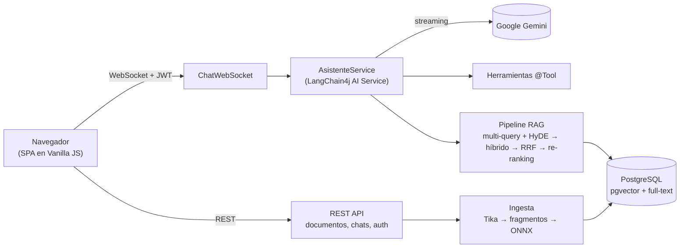

# Asistente Contextual Corporativo


Asistente conversacional que responde preguntas sobre los documentos internos de una empresa mediante **RAG (Retrieval-Augmented Generation)**: sube PDF, DOCX o TXT y pregunta por su contenido en lenguaje natural. Las respuestas llegan en streaming y citan las fuentes consultadas.

Es mi Trabajo de Fin de Grado en Ingeniería Informática (Universidad Pontificia de Salamanca, calificación **9,4**). La memoria es un estudio de las técnicas de RAG y agentes con LLM, y este repositorio es su implementación. Después de la defensa sigo desarrollándolo: seguridad multiempresa, streaming, despliegue con Docker y, a continuación, tests y evaluación de la calidad del RAG.

<!-- TODO: GIF de demostración (subir documento → pregunta → respuesta en streaming con fuentes) -->

---

## Qué hace

- **Chat en streaming por WebSocket.** La respuesta aparece a medida que el modelo la genera. Un filtro con estado elimina los bloques de razonamiento interno (`<thinking>`), aunque lleguen partidos entre fragmentos.
- **Búsqueda híbrida.** Combina búsqueda semántica (pgvector) y búsqueda por palabras clave (full-text de PostgreSQL en español). Los resultados se fusionan con *Reciprocal Rank Fusion* y se reordenan por similitud con la pregunta.
- **Transformación de consultas.** Antes de buscar, la pregunta se reformula en varias variantes y en una respuesta hipotética (HyDE). Esto lo hace un modelo ligero aparte, para no retrasar la respuesta; los saludos y las preguntas por el catálogo se saltan este paso, y las transformaciones se guardan en caché.
- **Embeddings locales.** Los documentos se vectorizan dentro del propio proceso con un modelo ONNX (`bge-small-en-q`, 384 dimensiones). El texto de los documentos no se envía a ningún servicio externo para vectorizarlo; solo los fragmentos recuperados llegan al LLM.
- **Herramientas (function calling).** El modelo puede consultar el catálogo de documentos, buscar dentro de un documento concreto, obtener estadísticas de la base de conocimiento, generar informes en Markdown, leer ficheros de un directorio aislado y consultar la web o los tipos de cambio.
- **Multiempresa y multiusuario.** Cada usuario pertenece a una empresa (claim `company_id` del JWT). Documentos, búsquedas, estadísticas e informes quedan aislados por empresa, y cada usuario solo ve sus propias conversaciones.
- **Memoria conversacional persistente** en PostgreSQL, con una ventana de 10 mensajes por sesión.

## Arquitectura



La empresa del usuario no viaja en un `ThreadLocal`, porque se perdería en los hilos de streaming. Va dentro del identificador de memoria de LangChain4j (`ContextoSesion`), así que el enrutador de consultas y las herramientas la reciben de forma explícita en cualquier hilo.

## Puesta en marcha

### Opción A: Docker Compose (recomendada)

Solo necesitas Docker y una API key de [Google AI Studio](https://aistudio.google.com).

```bash
git clone https://github.com/Gonzaloogm/TFG-GonzaloGardon.git
cd TFG-GonzaloGardon/asistente-contextual-backend
cp .env.example .env
```

Rellena en `.env` estas tres variables:

```dotenv
GEMINI_API_KEY=tu_clave
ADMIN_KEY=una_clave_larga_para_la_api_de_administracion
BOOTSTRAP_ADMIN_PASSWORD=contraseña_del_usuario_admin
```

```bash
docker compose up --build
```

Abre **http://localhost:8080** e inicia sesión con el usuario `admin` y la contraseña de `BOOTSTRAP_ADMIN_PASSWORD`. La imagen se compila desde el código fuente, así que no hace falta tener Java instalado. Las claves JWT se generan solas la primera vez y se guardan en un volumen, igual que la base de datos.

### Opción B: modo desarrollo

Necesitas **JDK 21** (Quarkus 3.17 no funciona con Java 25) y Docker para la base de datos.

```bash
cd asistente-contextual-backend
cp .env.example .env              # basta con GEMINI_API_KEY
./scripts/generar-claves-jwt.sh   # crea keys/ (ignorada por git)

docker run -d --name pgvector-postgres \
  -e POSTGRES_USER=postgres -e POSTGRES_PASSWORD=postgres \
  -e POSTGRES_DB=asistente_contextual \
  -p 5432:5432 pgvector/pgvector:pg16

./mvnw quarkus:dev
```

En modo desarrollo, la clave de administración y la contraseña de `admin` tienen valores locales por defecto (ver `application.properties`). En producción no los tienen: si faltan, la aplicación no arranca.

### Usuarios

El usuario `admin` se crea automáticamente en la empresa `empresa-alpha` si la tabla de usuarios está vacía. Para crear más usuarios y empresas se usa la API de administración (cabecera `X-Admin-Key`). Tienes ejemplos con `curl` en [`Comandos_Gestion_Usuarios`](asistente-contextual-backend/Comandos_Gestion_Usuarios).

## Configuración

Todas las variables se leen de `asistente-contextual-backend/.env` (ignorado por git) o del entorno.

| Variable | Obligatoria | Uso |
|---|---|---|
| `GEMINI_API_KEY` | Sí | Clave de Google Gemini |
| `GEMINI_MODEL` | No | Modelo principal del chat (por defecto `gemini-3.5-flash`) |
| `GEMINI_AUX_MODEL` | No | Modelo ligero que reformula las consultas (por defecto `gemini-3.5-flash-lite`) |
| `ADMIN_KEY` | En producción | Clave de la API de administración de usuarios |
| `BOOTSTRAP_ADMIN_PASSWORD` | En producción | Contraseña del usuario `admin` inicial |
| `DB_URL`, `DB_USER`, `DB_PASSWORD` | No | Conexión a PostgreSQL |
| `JWT_PRIVATE_KEY_LOCATION`, `JWT_PUBLIC_KEY_LOCATION` | No | Rutas de las claves JWT (por defecto, `keys/`) |
| `APP_PORT` | No | Puerto publicado por Docker Compose (por defecto, 8080) |

## Seguridad

- Autenticación con JWT firmado con RSA. Las claves no están en el repositorio ni en la carpeta web pública.
- Ningún secreto en el código: sin valores por defecto en producción (*fail-fast*).
- Aislamiento por empresa en todas las consultas a la base de datos vectorial y en la búsqueda por palabras clave. El `company_id` lo pone siempre el servidor a partir del token, nunca el cliente.
- Las herramientas no pueden ejecutar comandos de shell. La lectura de ficheros está confinada a un directorio *sandbox*: las rutas se resuelven con `toRealPath()`, de modo que ni `../` ni los enlaces simbólicos permiten salir de él.
- Comprobación de propietario en todas las operaciones sobre conversaciones, tanto por REST como por WebSocket.

## Tests

```bash
cd asistente-contextual-backend
./mvnw test
```

Hay tests unitarios del filtro de `<thinking>` en streaming y del confinamiento al sandbox. El test de integración necesita PostgreSQL en marcha.

## Limitaciones conocidas

Son las líneas de trabajo pendientes:

- **Modelo de embeddings en inglés** (`bge-small-en`) aplicado a documentos en español. Un modelo multilingüe debería mejorar la recuperación.
- **Fragmentación por caracteres** (300 con solapamiento de 30), no por tokens ni por estructura del documento.
- **No hay evaluación cuantitativa del RAG** todavía (fidelidad, relevancia del contexto). Es el siguiente paso planificado.
- El **catálogo de documentos** se guarda en un JSON en disco además de en la base de datos, y los dos pueden desincronizarse.
- El esquema se gestiona con `hibernate-orm.database.generation=update`, sin migraciones versionadas.
- Pocos tests automáticos y sin integración continua por ahora.

## Hoja de ruta

- [x] Seguridad: secretos fuera del código, sandbox de herramientas, aislamiento por empresa y por usuario
- [x] Respuestas en streaming
- [x] Despliegue con Docker Compose
- [ ] Tests de integración con Testcontainers e integración continua con GitHub Actions
- [ ] Banco de evaluación del RAG en español (RAGAS)
- [ ] Embeddings multilingües y fragmentación por tokens

## Stack

Java 21 · Quarkus 3.17 (REST, WebSockets Next, Hibernate ORM con Panache, SmallRye JWT) · LangChain4j / Quarkus LangChain4j · Google Gemini · PostgreSQL 16 + pgvector · ONNX Runtime · Apache Tika · Vanilla JS + marked + DOMPurify · Docker

---

Gonzalo Gardón · Trabajo de Fin de Grado, Ingeniería Informática, Universidad Pontificia de Salamanca
